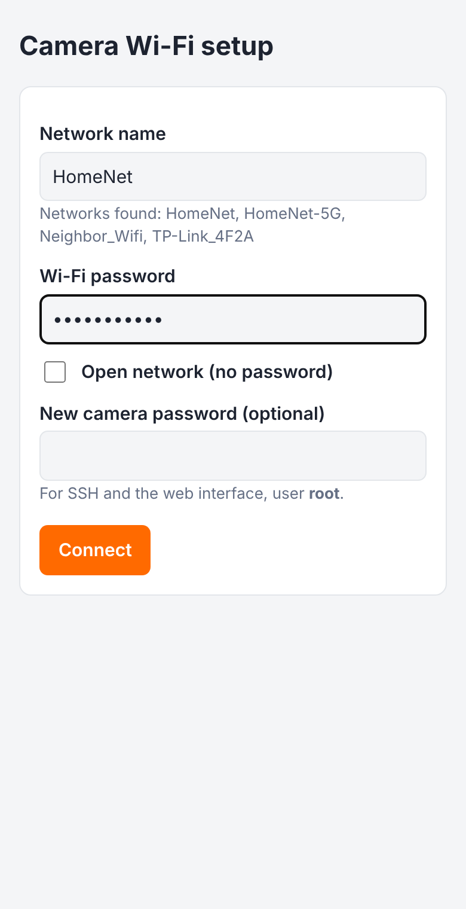
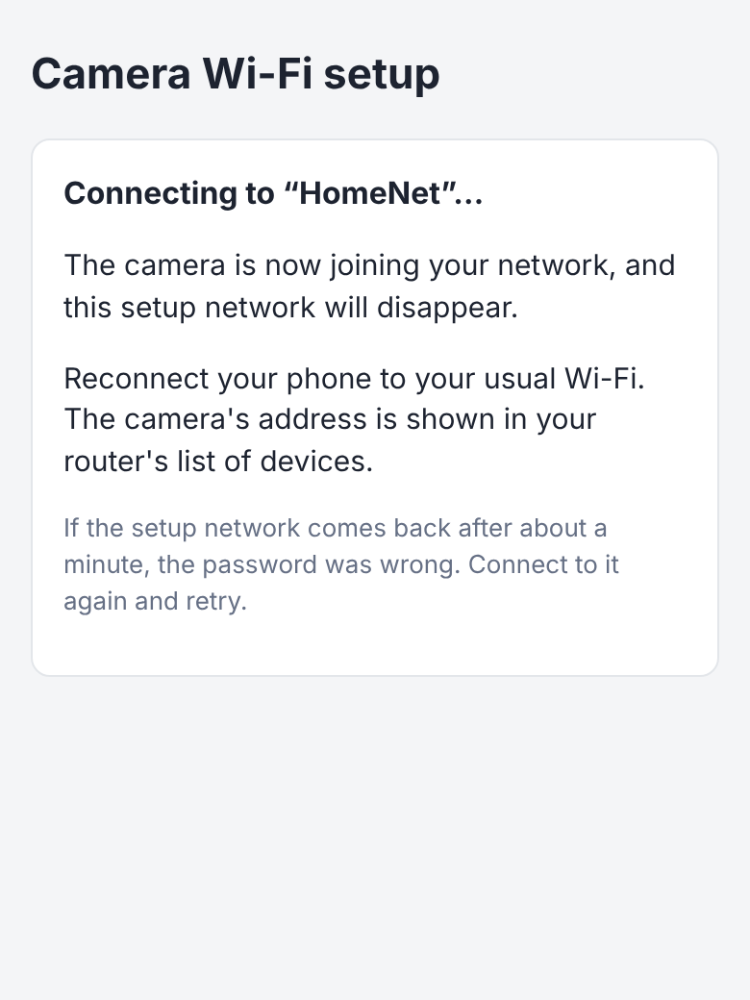
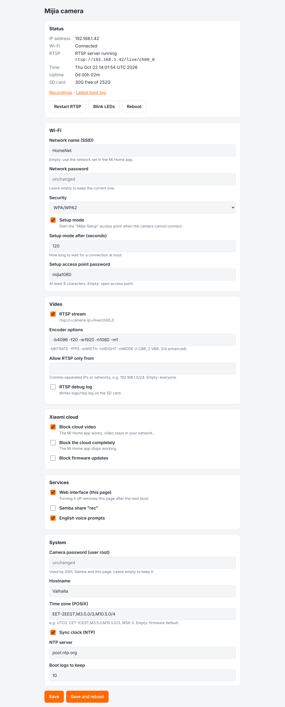
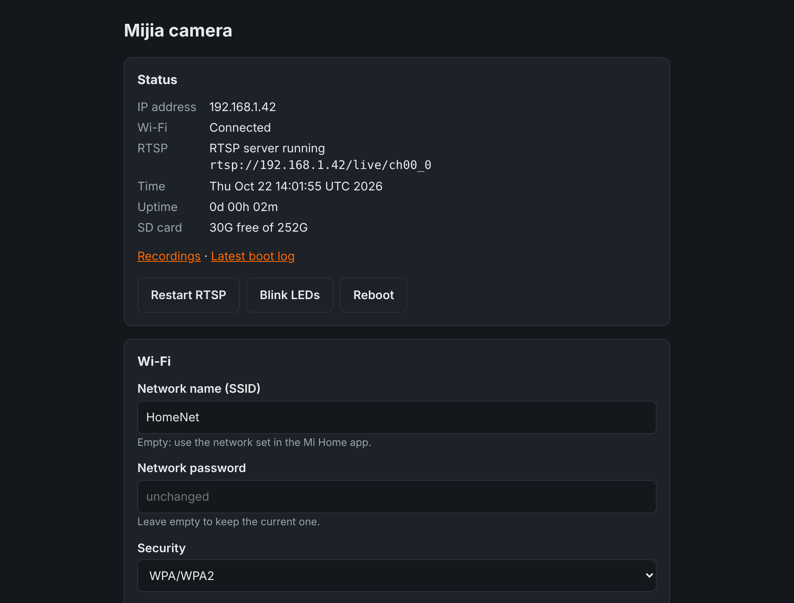

# mijia-1080P-hacks

A toolset that runs from the SD card and adds features to the Xiaomi Mijia
1080p camera. Nothing is flashed: take the card out and the camera boots
the stock firmware again (except for the English voice prompts and the OTA
hook, see below).

## Features

| Feature | Setting in `midgard.ini` | Default |
|---|---|---|
| **Wi-Fi setup mode**: own access point + setup page when there is no Wi-Fi | `WIFI_SETUP_AP` | on |
| **Settings web page** (port 8080, with password) | `HTTP_ENABLED` | on |
| SSH and SFTP server (dropbear, port 22) | `SSH_ROOT_PASS` | always on |
| English voice prompts instead of Chinese | `ENGLISH_VOICE` | on |
| Local RTSP stream, restarted automatically if it crashes | `RTSP_ENABLED`, `CONFIG_LINE` | off |
| Limit RTSP to some IPs/networks | `RTSP_ALLOW` | everyone |
| Clock sync (NTP) and time zone | `NTP_ENABLED`, `TIMEZONE` | NTP on |
| Watchdog for SSH, web server and Samba | (always) | on |
| Snapshot `/snapshot.php` (needs `tools/bin/ffmpeg`) | — | — |
| Block video streaming to the Xiaomi cloud | `CLOUD_STREAMING_DISABLED` | off |
| Cut the camera off from the Xiaomi cloud | `CLOUD_DISABLED` | off |
| Block firmware (OTA) updates | `DISABLED_OTA` | off |
| Samba share `rec` with the recordings | `SAMBA_ENABLED` | off |
| Wi-Fi network set from the SD card | `miio_ssid`, `miio_passwd`, `miio_key_mgmt` | empty |
| Custom hostname | `HOSTNAME` | `Valhalla` |

## Screenshots

Wi-Fi setup page on a phone (`http://192.168.14.1` on the `Mijia-Setup-XXXX` network):

<p>
  
  
</p>

Settings page (`http://<camera-ip>:8080`), light and dark mode:

<p>
  
  
</p>

## Installation

1. Format a microSD card as **FAT32**.
2. Copy the **contents** of the `sdcard/` folder to the root of the card
   (`ft/`, `tools/`, `ft_config.ini`, `midgard.ini`, `valhalla.sh`, ...).
3. Optional: edit `midgard.ini` (you can also do it later in the web page).
4. Put the card in the camera and power it on. When the hack has finished
   starting, both LEDs blink for about 5 seconds.
5. If the camera has no Wi-Fi yet, it opens its own network after about
   20 seconds, see [First Wi-Fi setup](#first-wi-fi-setup).
6. Open `http://<camera-ip>:8080` (user `root`, password `qwerty123456`)
   and **set a new password** under *System*.
7. Check `logs/boot-*.log` on the card if something does not work.

### First Wi-Fi setup

1. Power the camera on and wait about 30 seconds.
2. On your phone, connect to the camera's Wi-Fi network:
   * its own pairing network **`mijia-camera-…_mibtXXXX`** (open), if the
     firmware started it; the setup page works there and the camera leaves
     that network alone while you use it, or
   * **`Mijia-Setup-XXXX`**, password **`mijia1080`** (`SETUP_AP_PASS`),
     which the camera starts when no other network is up.
3. Open **http://192.168.14.1** in the browser.
4. Pick your network, enter its password (and a new camera password), and
   press *Connect*.
5. The setup network disappears and the camera joins your Wi-Fi. If the
   password was wrong, the setup network comes back after about a minute.

If the page does not open, try **http://192.168.14.1:8080** (the settings
page, user `root`), and check `logs/boot-*.log` on the card.

The camera also falls back to setup mode when the saved network is not
reachable at boot, and tries the saved network again every 10 minutes
(`SETUP_RETRY`). To pair the camera with the Mi Home app instead, set
`WIFI_SETUP_AP=0`.

`midgard.ini` may be edited on Windows: Windows line endings are handled.
Do not edit the `.sh` files with an editor that saves Windows line endings.

## Usage

All services use the user **`root`** and the password from `SSH_ROOT_PASS`.

* **SSH:** `ssh root@<camera-ip>`
* **SFTP / scp:** `sftp root@<camera-ip>`. OpenSSH 9+ `scp` works too, because it
  uses SFTP. SFTP only works when the camera mounts the card at
  `/mnt/media/mmcblk0p1`, the normal case.
* **RTSP:** `rtsp://<camera-ip>/live/ch00_0`. **Also set
  `CLOUD_STREAMING_DISABLED=1`**: the firmware's `miio_avstreamer` reads the
  same encoder channel as `rtsp_basic`, each frame goes to only one of them,
  and the stream turns into smeared blocks. With it set, the camera no longer
  records to the SD card itself; record with Frigate or another NVR instead.
  Watch it in VLC or ffmpeg:
  `ffplay -rtsp_transport tcp rtsp://192.168.1.50/live/ch00_0`.
  The stream starts about 15 seconds after the script runs.
  `CONFIG_LINE` sets bitrate (`-b`, kbps), frame rate (`-f`), size
  (`-w`/`-h`) and bitrate mode (`-m`: 1 CBR, 2 VBR, 3 enhanced CBR,
  4 enhanced VBR). Set `RTSP_LOG=1` to log the server output to `logs/rtsp.log`.
  Control it over SSH with `/tmp/rtsp_start.sh start|stop|status`.
* **Web:** `http://<camera-ip>:8080`: status, all settings, reboot, RTSP
  restart, LED blink to find the camera, latest boot log, and a recordings
  browser (`/media.php`, plays in the browser, Safari included). Most
  settings take effect after a reboot. The login (user `root`, password
  `SSH_ROOT_PASS`) is checked by the PHP pages: basic auth in the bundled
  lighttpd build rejects every password.
* **Snapshot:** `http://<camera-ip>:8080/snapshot.php` returns a JPEG when an
  ARM (armv5) static build of `ffmpeg` is copied to `tools/bin/ffmpeg` and
  RTSP is enabled.
* **Samba:** `\\<camera-ip>\rec`. `nmbd` does not work, so connect by IP.

The SSH host key is created on the first boot and saved to
`tools/dropbear/dropbear_ecdsa_host_key`, so it stays the same after reboots.

### Wi-Fi

Leave `miio_ssid` empty to keep the network set up in the Mi Home app.
When it is set, the camera joins that network on every boot. Set
`miio_key_mgmt=NONE` for an open network. The settings are not written to
the camera, so remove the card and the camera goes back to its own Wi-Fi
settings.

### Cloud options

* `CLOUD_DISABLED=1`: turns off the Xiaomi cloud: the Mi Home connection
  (`miio_client`), BLE pairing, OTA, `miot_devicekit`, `miot_qrcode` and
  `restartd`. The Mi Home app will not work. The video service keeps running.
  Recommended when the camera was set up with the Wi-Fi setup page, because
  such a camera cannot be used with Mi Home anyway. The setup page has a
  checkbox for it.
* `CLOUD_STREAMING_DISABLED=1`: also stops `miio_avstreamer`, the firmware's
  video service. No video leaves your network, but recording to the SD card
  and the voice prompts stop too. RTSP keeps working.

### Time

`NTP_ENABLED=1` syncs the clock with `NTP_SERVER` once the camera is online
and every 6 hours. Firmware without `ntpd` (e.g. 3.3.6_0099) gets the time
from the `Date` header of a plain HTTP request instead. `TIMEZONE` takes a
POSIX TZ string, for example `UTC0`, `CET-1CEST,M3.5.0,M10.5.0/3` (Central
Europe), `EET-2EEST,M3.5.0/3,M10.5.0/4` (Kyiv), `MSK-3` (Moscow).

## How it works

* The firmware has a factory-test boot hook: when the card has
  `ft_config.ini` and `ft/ft_boot.sh` with a matching signature
  (`ft/secret.bin`), the camera runs `ft_boot.sh` at boot. That script mounts
  the card at `/tmp/sd` and runs `valhalla.sh`.
* `valhalla.sh` reads `midgard.ini`, copies `/etc` to a writable copy in
  `/tmp`, sets the root password, starts the services, and logs every step to
  `logs/` (the newest `LOG_KEEP` boot logs are kept). A lock file makes sure
  it runs only once per boot.
* `tools/valhallad.sh` keeps running in the background from `/tmp`: Wi-Fi
  setup mode, the service watchdog and NTP.
* **Survives updates:** unless `DISABLED_OTA=1`, `tools/post-ota.sh` is
  installed as the firmware's post-update hook. After an update,
  `tools/inject.sh` writes `tools/wifi_start.sh` into the new data partition.
  That patched script starts `valhalla.sh` at boot.
* **Changes to the camera's flash:** the English voice prompts (symlinks in
  `/mnt/data/sound`) and the OTA hook (`/mnt/data/miio_ota/post-ota.sh`). Both
  are written only when needed.

### Editing `ft/ft_boot.sh`

The camera checks `ft/secret.bin` against the MD5 of `ft_boot.sh`. If you
change `ft_boot.sh`, sign it again on a PC that has `openssl`:

```sh
cd /path/to/sdcard
sh tools/sign_ft_boot.sh
```

## Files

| Path | Purpose |
|---|---|
| `ft_config.ini`, `ft/` | Factory-test boot hook and its signature |
| `midgard.ini` | User configuration |
| `valhalla.sh` | Main script |
| `tools/valhalla_lib.sh` | Shared shell helpers (config, logging, Wi-Fi) |
| `tools/valhallad.sh` | Background helper: Wi-Fi setup mode, watchdog, NTP |
| `tools/rtsp_start.sh` | RTSP launcher and watchdog |
| `tools/www/` | Settings page (`index.php`), setup page (`setup/`), snapshot |
| `tools/wifi_start.sh` | Wi-Fi start script (stock 3.3.6 + the network from `midgard.ini`); bind-mounted over the stock one at boot (RAM only) and written to flash after an OTA |
| `tools/post-ota.sh`, `tools/inject.sh` | OTA persistence |
| `tools/sign_ft_boot.sh` | Re-signs `ft/ft_boot.sh` |
| `tools/dropbear/`, `tools/sftp-server` | SSH/SFTP server |
| `tools/rtsp_basic` | RTSP server ([source](https://github.com/willthrom/rtspServer_gm)) |
| `tools/bin/`, `tools/etc/` | lighttpd, PHP, Samba (see `tools/build.txt`) |

## Security notes

* Change the default password. It protects SSH, the web interface and Samba.
* RTSP has **no password** (the `rtsp_basic` server does not support one).
  Anyone on your network can watch the stream unless you set `RTSP_ALLOW`.
  Do not expose it to the Internet.
* Change `SETUP_AP_PASS` if neighbours could reach the setup network.
* Older releases shipped a shared SSH host key. It has been removed: each
  camera now creates its own on first boot.

## Development

GitHub Actions (`.github/workflows/check.yml`) runs shellcheck, PHP and
signature checks on every push and builds `mijia-1080p-sdcard.zip`. Push a
`v*` tag to publish it as a release.

Development details are in the
[wiki](https://github.com/Filipowicz251/mijia-1080P-hacks/wiki).
